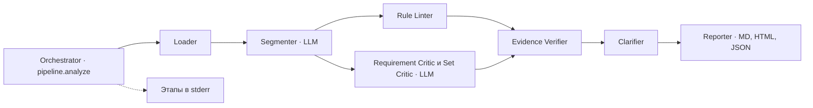

# reqcheck — агент проверки требований

Агент читает документ с требованиями (PDF, DOCX, MD, TXT, HTML) и пишет отчёт на русском.
Отчёт содержит: паспорт прогона, таблицу сегментации, проверку каждого требования и набора,
уточняющие вопросы, сводку и вердикт. Каждый вывод подкреплён точной цитатой и местом в документе.

## Установка

Требуется Python 3.11 или новее.

```bash
git clone https://github.com/stritphatographir/Bcc.git
cd Bcc
```

Windows (PowerShell):

```powershell
python -m venv .venv
.venv\Scripts\Activate.ps1
pip install -r requirements.txt
```

Linux / macOS:

```bash
python3 -m venv .venv
source .venv/bin/activate
pip install -r requirements.txt
```

## Ключ модели и выбор модели

Скопируйте `.env.example` в `.env` и заполните. Файл `.env` не попадает в git.

**Gemini.** Получите ключ на <https://aistudio.google.com/apikey>, затем в `.env`:

```dotenv
GEMINI_API_KEY=<ваш ключ>
LLM_BASE_URL=https://generativelanguage.googleapis.com/v1beta/openai/
LLM_MODEL=<идентификатор актуальной модели Gemini из списка>
```

Выберите модель из [списка Gemini](https://ai.google.dev/gemini-api/docs/models) и укажите её ID.
Оставьте `LLM_API_KEY` пустым, чтобы клиент использовал `GEMINI_API_KEY`.

**Локальный endpoint (OpenAI-совместимый: Ollama, vLLM, LM Studio).** Ключ не нужен:

```dotenv
LLM_BASE_URL=http://monster-server:8080/v1
LLM_MODEL=swift-1.5-iq3_s
LLM_API_KEY=
```

Для другого OpenAI-совместимого провайдера задайте его `LLM_BASE_URL`, `LLM_MODEL` и
`LLM_API_KEY`. `REQCHECK_TIMEOUT` задаёт тайм-аут запроса в секундах.
Для указанного локального Qwen по умолчанию используется компактный ответ, тайм-аут 150 секунд
и три независимые проверки критиками. `REQCHECK_DISABLE_THINKING=0` возвращает режим рассуждения,
а `REQCHECK_CRITIC_VOTES=1` запускает одного критика на задачу. Согласие в отчёте показывает
долю голосов за вывод. После голосования цитаты снова проходят сверку.

## Запуск (одна команда)

```bash
python -m reqcheck examples/requirements.md -o reports/report.md
```

Отчёт пишется в `reports/report.md`, `reports/report.html`, `reports/report.json`.
Журнал `reports/report.trace.jsonl` показывает этапы, хеши запросов, время, попадания кэша
и токены, если провайдер их указал.
В консоль (`stderr`) печатаются этапы работы агентов. Если модель недоступна, агент
выдаёт отчёт только с правилами линтера и помечает это в паспорте как «Только правила».

Интерактивный режим: агент задаёт уточняющие вопросы в терминале, принимает ответы,
перепроверяет затронутые требования и пишет диалог в отчёт:

```bash
python -m reqcheck examples/requirements.md -o reports/report.md --interactive
```

## Что внутри отчёта

- **Паспорт прогона**: документ, SHA-256, модель, провайдер, версия из git, время,
  число обращений к LLM, попадания кэша, число отброшенных выводов, режим проверки.
- **Каждый вывод**: нарушение, серьёзность, точная цитата, локатор (строка/раздел/таблица),
  объяснение и переписанная формулировка требования.
- **Сверка цитат (Evidence Verifier)** проверяет совпадение цитаты с исходным текстом
  по указанному локатору. Число отброшенных выводов указано в паспорте.
- **Уточняющие вопросы**: сгруппированы по адресатам, привязаны к ID выводов.
- **Моделирование сценариев**: сверяет таблицу решений с критериями приёмки, проверяет
  границы условий и ищет правила с несовместимыми результатами для одного входа.
- **Финтех и API**: правила проверяют денежные единицы, округление, повторы, возвраты,
  данные карты, типы полей и покрытие HTTP-статусов.

## Веб-демо

```bash
python -m uvicorn reqcheck.webapp:app --host 127.0.0.1 --port 8000
```

Откройте <http://127.0.0.1:8000>, загрузите файл и дождитесь завершения этапов.
В разделе «Источник» выберите дефект, чтобы перейти к цитате. В разделе «Вопросы»
введите ответы и нажмите «Перепроверить с ответами». Тесты, связи и предлагаемые правки
доступны в отдельных разделах. Кнопки экспорта сохраняют Markdown, HTML и JSON.

## Архитектура

Каждый агент делает одну работу, передача данных типизирована (pydantic), все обращения
к LLM идут через один клиент (retry, JSON-схема, кэш по хешу промпта, temperature 0).



## Тесты без сети

```bash
pytest
```

Тесты используют имитацию ответов модели и выполняются без сети.

## Измерение качества

Команда `python -m eval.score` проверяет разметку сохранённого отчёта, печатает
полноту, точность по оценённым выводам, пропуски и результаты вариантов проверки.
Методика и формат разметки описаны в [eval/README.md](eval/README.md).

Для воспроизведения профиля конкурсного отчёта установите `REQCHECK_CRITIC_VOTES=1`
и выберите `swift-1.5-iq3_s` на совместимом локальном сервере. Один голос дал выше
полноту, поэтому в сохранённом отчёте использован этот профиль.
Отдельный холодный прогон занял 250 секунд и сделал 19 запросов к Qwen.
Сохранённый отчёт использует 20 проверенных ответов из кэша.

| Профиль | Recall | Precision | Оценённые выводы |
| --- | --- | --- | --- |
| Только линтер | 5/30 | 21/21 | 21/21 |
| + критики, один голос | 17/30 | 53/62 | 62/84 |
| + первоначальный симулятор | 17/30 | 53/62 | 62/84 |
| + голосование, три голоса | 12/30 | 32/33 | 33/44 |
| Полный анализ до сверки цитат, один голос | 23/30 | 67/80 | 80/104 |
| Полный анализ после сверки цитат, один голос | 23/30 | 67/76 | 76/100 |

## Экспорт и сравнение версий

```bash
python -m reqcheck export reports/report.json -o reports/review
python -m reqcheck diff specs/old.md specs/new.md -o reports/diff.md
```

Экспорт создаёт DOCX и выгрузки Jira в CSV и JSON. CSV можно загрузить через импорт
Jira с сопоставлением полей. В JSON сохранены поля задачи для интеграции.
Для сравнения можно передать готовые JSON-отчёты и повторно использовать результаты.
Сравнение связывает выводы по критерию и цитате, включая перемещённые строки.

GitHub Actions проверяет изменённые спецификации в `specs/` и `examples/`.
Отчёты доступны в артефакте `requirements-review`. Правила работают без ключа.
Для прогона модели задайте переменные `REQCHECK_LLM_BASE_URL`, `REQCHECK_LLM_MODEL`
и секрет `REQCHECK_LLM_API_KEY` в настройках репозитория.

---

## English (short)

`reqcheck` reads a requirements document (PDF/DOCX/MD/TXT/HTML) and writes a Russian
report: run passport, segmentation table, per-requirement and set-level checks,
prioritized clarifying questions, summary and verdict. Every finding carries a verbatim
quote and a locator; an Evidence Verifier drops findings whose quote is not in the source.
Set `GEMINI_API_KEY` + `LLM_MODEL` (no retired default — set a current Gemini model) or
point `LLM_BASE_URL`/`LLM_API_KEY` at any OpenAI-compatible endpoint, including a local
model. Run: `python -m reqcheck examples/requirements.md -o reports/report.md`
(MD + HTML + JSON). `--interactive` asks clarifying questions and re-checks. `pytest`
runs offline with a mocked LLM.
