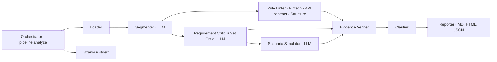

# reqcheck — агент проверки требований

Агент читает документ с требованиями (PDF, DOCX, MD, TXT, HTML) и пишет отчёт на русском.
Отчёт содержит: паспорт прогона, таблицу сегментации, проверку каждого требования и набора,
уточняющие вопросы, сводку и вердикт. Каждый вывод подкреплён точной цитатой и местом в документе.


## Навигация для жюри

| Что | Где |
| --- | --- |
| Отчёт по документу организаторов | [report.md](reports/report.md) · [HTML для браузера](reports/report.html) · [PDF](reports/report.pdf) · [DOCX](reports/report.docx) · [JSON](reports/report.json) |
| Видеодемо с русской озвучкой, 2:47 | [docs/demo.mp4](docs/demo.mp4) |
| Запуск одной командой | [ниже](#запуск-одна-команда) |
| Архитектура агентов и схема | [ниже](#архитектура) |
| Уточняющие вопросы и вердикт в отчёте | [ниже](#что-внутри-отчёта) |
| Метрики качества: recall, precision, абляции | [ниже](#бенчмарк) |
| Офлайн-тесты без ключа | [ниже](#тесты-без-сети) |
| Веб-демо: загрузка, этапы, ответы на вопросы | [ниже](#веб-демо) |

## Демонстрация для жюри

В сохранённом отчёте Gemini найдите D-036. Правило относит операцию к месяцу
исходного события, а приёмочный тест ждёт изменения счётчика следующего месяца.
С ним связан вопрос Q-02. Для перепроверки с ответом загрузите документ в веб-демо
и выберите вопрос из нового прогона. Номера выводов и вопросов могут измениться.

В записи с Qwen показан другой пример. Ф-3 запрещает второй push за месяц, а Ф-4
предписывает отправить его после смены порога и нового достижения. Симулятор выводит обе цитаты.

- [Посмотреть запись с русской озвучкой и субтитрами, 2:47](docs/demo.mp4)
- [Открыть отчёт по документу организаторов](reports/report.md) · [Файл HTML для просмотра в браузере](reports/report.html)
- [Исходный документ](examples/requirements.md) · [Разметка и методика оценки](eval/README.md)

## Установка

Требуется Python 3.11 или новее.

```bash
git clone https://github.com/stritphatographir/Bcc.git
cd Bcc
```

Windows (PowerShell):

```powershell
python -m venv .venv
.venv\Scripts\Activate.ps1
pip install -r requirements.txt
```

Linux / macOS:

```bash
python3 -m venv .venv
source .venv/bin/activate
pip install -r requirements.txt
```

## Ключ модели и выбор модели

По умолчанию агент работает с **Gemini** (бесплатный тариф Google AI Studio).

1. Откройте <https://aistudio.google.com/apikey>, войдите в Google-аккаунт и нажмите
   «Create API key».
2. Скопируйте пример конфига и вставьте ключ:

   ```bash
   cp .env.example .env        # Windows: copy .env.example .env
   ```

   ```dotenv
   GEMINI_API_KEY=<ваш ключ>
   ```

3. Больше ничего задавать не нужно. Модель по умолчанию — `gemini-3.8-flash`
   (стабильная модель из [списка Gemini](https://ai.google.dev/gemini-api/docs/models),
   ноябрь 2026). Другую модель задаёт `LLM_MODEL`, например `gemini-3.5-flash-lite`:
   у неё выше лимиты бесплатного тарифа.

Бесплатный тариф ограничивает число запросов в минуту. Агент держит не больше
двух параллельных запросов (`REQCHECK_CONCURRENCY`) и при ответе 429 или 5xx ждёт
по заголовку `Retry-After` или 2, 4, 8 … с (до `REQCHECK_MAX_RETRIES` повторов).
Если резерв не настроен, при неверном ключе или потере связи агент прекращает
обращения к серверу и указывает причину в паспорте. Если ответов модели нет,
отчёт содержит результаты проверки по правилам.

**Другой OpenAI-совместимый провайдер** (OpenAI, OpenRouter, Ollama, vLLM, LM Studio):

```dotenv
LLM_BASE_URL=http://localhost:11434/v1
LLM_MODEL=qwen3:8b
LLM_API_KEY=
```

Если сервер поддерживает `response_format` с типом `json_schema` (например, llama.cpp),
задайте `REQCHECK_JSON_SCHEMA=1`. Тогда сервер получает схему ответа каждого агента.
Клиент проверяет полученный JSON, а в отчёт попадают только выводы с подтверждёнными цитатами.

### Если основная модель отвечает долго

Для автоматического перехода с локальной Qwen на Gemini укажите основную модель
в `LLM_BASE_URL` и `LLM_MODEL`. Добавьте в `.env` следующие строки и действующий
`GEMINI_API_KEY`. Используйте облачный резерв для документов, которые разрешено
передавать Google.

```dotenv
LLM_BASE_URL=http://monster-server:8080/v1
LLM_MODEL=swift-1.5-iq3_s
REQCHECK_BACKUP_BASE_URL=https://generativelanguage.googleapis.com/v1beta/openai/
REQCHECK_BACKUP_MODEL=gemini-3.5-flash-lite
REQCHECK_SWITCH_AFTER=30
REQCHECK_CRITIC_VOTES=1
REQCHECK_CONCURRENCY=2
```

Если сервер отклоняет соединение, агент сразу переходит к резерву. Если попытка
TCP-соединения остаётся без ответа, её тайм-аут составляет 3 секунды. Более
короткий настроенный тайм-аут сохраняется.
В этом режиме у каждого запроса к основной модели есть общий лимит в секундах,
включая получение тела ответа и повторы. При истечении лимита или потере связи
агент один раз переключается на резерв и повторяет текущую проверку. Завершённые
проверки сохраняются. У запроса к резерву свой такой же лимит. Если оба сервера
недоступны, агент сохраняет результаты выполненных проверок и правила линтера.
CLI и веб-интерфейс показывают переключение. В паспорте указаны причина и число
запросов к каждой модели. Порядок действий при отключении питания есть в
[инструкции для показа](docs/demo.md).

Конкурсный отчёт в `reports/` получен на Gemini `gemini-3.5-flash-lite`.
Для видеодемо использована локальная Qwen (`swift-1.5-iq3_s`,
`LLM_BASE_URL=http://monster-server:8080/v1`). Для этой конфигурации включены компактный ответ, тайм-аут 150 секунд
и три голоса критиков. `REQCHECK_CRITIC_VOTES=1` запускает одного критика на задачу.
Согласие в отчёте показывает долю голосов за вывод. После голосования цитаты снова
проходят сверку.

## Запуск (одна команда)

```bash
python -m reqcheck examples/requirements.md -o reports/run/report.md
```

Новый отчёт пишется в `reports/run/` в файлы `report.md`, `report.html`, `report.pdf` и `report.json`.
Команда оценки использует сохранённый конкурсный отчёт `reports/report.json`.
Журнал `reports/run/report.trace.jsonl` показывает этапы, хеши запросов, время, попадания кэша
и токены, если провайдер их указал.
В консоль (`stderr`) печатаются этапы работы агентов. Если модель недоступна, агент
выдаёт отчёт только с правилами линтера и помечает это в паспорте как «Только правила».

Интерактивный режим: агент задаёт уточняющие вопросы в терминале, принимает ответы,
перепроверяет затронутые требования и пишет диалог в отчёт:

```bash
python -m reqcheck examples/requirements.md -o reports/run/interactive.md --interactive
```

## Что внутри отчёта

- **Паспорт прогона**: документ, SHA-256, модель, провайдер, версия из git, время,
  число обращений к LLM, попадания кэша, число отброшенных выводов, режим проверки.
- **Каждый вывод**: нарушение, серьёзность, точная цитата, локатор (строка/раздел/таблица),
  объяснение и переписанная формулировка требования.
- **Сверка цитат (Evidence Verifier)** проверяет совпадение цитаты с исходным текстом
  по указанному локатору. Число отброшенных выводов указано в паспорте.
- **Уточняющие вопросы (Clarifier)**: дефекты, которые цитируют одни и те же места, объединяются
  в один вопрос (полная связь по пересечению цитат, Jaccard ≥ 0,5), поэтому общая строка-контекст
  не склеивает разные темы. Ведущим становится прямой вопрос с вариантами ответа, остальные
  формулировки сохраняются под ним («Также: …»). Вопрос адресуется по цитатам и критерию:
  разработке, QA, ИБ, владельцу продукта или аналитику. Блокирующие вопросы перечислены первыми.
  `--interactive` задаёт только главные вопросы (`REQCHECK_INTERACTIVE_LIMIT`, по умолчанию 8).
- **Структура документа (без LLM)**: схемы процесса и последовательности только с успешным путём
  и одно правило, записанное в двух разделах.
- **Моделирование сценариев**: сверяет таблицу решений с критериями приёмки, проверяет
  границы условий и ищет правила с несовместимыми результатами для одного входа.
- **Финтех и API**: правила проверяют денежные единицы, округление, повторы, возвраты,
  данные карты, типы полей и покрытие HTTP-статусов.

## Веб-демо

```bash
python -m uvicorn reqcheck.webapp:app --host 127.0.0.1 --port 8000
```

Откройте <http://127.0.0.1:8000>, загрузите файл и дождитесь завершения этапов.
В разделе «Источник» выберите дефект, чтобы подсветить цитаты. Кнопка с номерами
дефекта и вопроса откроет поле ответа. Введите решение и нажмите «Перепроверить с ответами».
После проверки появится число сохранённых ответов. Тесты, связи и предлагаемые правки
доступны в отдельных разделах. Кнопки экспорта сохраняют Markdown, HTML и JSON.

## Архитектура

Каждый агент делает одну работу, передача данных типизирована (pydantic), все обращения
к LLM идут через один клиент (retry, JSON-схема, кэш по хешу промпта, temperature 0).



## Тесты без сети

```bash
pytest
```

Тесты используют имитацию ответов модели и выполняются без сети.

## Бенчмарк

Команда `python -m eval.score` проверяет разметку сохранённого отчёта, печатает
полноту, точность по оценённым выводам, пропуски и результаты вариантов проверки.
Методика и формат разметки описаны в [eval/README.md](eval/README.md).

Замер от 27 ноября 2026, модель `gemini-3.5-flash-lite`, версия агента `e18312c`.
В базовом прогоне полнота составила 18/30 (60,0%), точность — 51/62 (82,3%).
После первого цикла результат составил 23/30 (76,7%) и 55/67 (82,1%).
На пятой дополнительной итерации финальный отчёт нашёл **27/30 (90,0%)** групп эталона.
Подтверждены **59/71 (83,1%)** выводов. Пропуски: G13, G16, G25.

Во всех строках использована одна сегментация. Симулятор построил 25 сценариев;
в этом прогоне они не добавили подтверждённых дефектов. При голосовании из трёх
ответов требуется совпадение большинства. Для финального отчёта выбран один голос,
который показал более высокую полноту.

| Профиль | Recall | Precision | Оценённые выводы |
| --- | --- | --- | --- |
| Детерминированные правила | 19/30 | 37/37 | 37/37 |
| + критики, один голос | 27/30 | 59/71 | 71/71 |
| + симулятор | 27/30 | 59/71 | 71/71 |
| + голосование, три голоса | 21/30 | 42/44 | 44/44 |
| + сверка цитат, три голоса | 21/30 | 42/44 | 44/44 |
| Финальный отчёт: один голос со сверкой цитат | 27/30 | 59/71 | 71/71 |

Markdown занял 77,34 с при первом вызове Gemini и ещё 4,05 с при полном
повторе с кэшем после ответа 429. PDF занял 55,29 с, независимый пример —
67,45 с. В паспорте финального отчёта указаны 0,22 с на анализ с 20 ответами из кэша.
В [более раннем прогоне Qwen без кэша](eval/runs/qwen-cold.json) Markdown занял 195 с.

Паспорт `reports/report.md` показывает «Запросы к модели в этом прогоне — 0»: отчёт
собран из 20 ответов Gemini, сохранённых в кэше по SHA-256 запроса. Прогон с живыми
вызовами модели без кэша сохранён в `eval/runs/qwen-cold.json` (20 запросов к Qwen).

Видео `docs/demo.mp4` записано на локальной модели Qwen (recall 25/30). Отправленный
отчёт построен моделью Gemini `gemini-3.5-flash-lite` (recall 27/30).

CLI и `eval.score` всегда печатают в UTF-8, чтобы консоль Windows не падала на кириллице.

### Второй документ: проверка на переобучение

Для `examples/merchant-settlement.md` список дефектов `eval/golden_settlement.md` (21 дефект)
составлен до запуска агента. Модель — локальная Qwen (Gemini в этой сети отвечал HTTP 403).

| Прогон | Recall | Precision |
| --- | --- | --- |
| [Слепой, до доработки](eval/runs/settlement-blind/report.md) | 6/21 (28,6%) | 20/23 (87,0%) |
| [После общих финтех-проверок](eval/runs/settlement-tuned/report.md) | 17/21 (81,0%) | 35/36 (97,2%) |

Второй прогон уже не слепой: проверки добавлены после разбора пропусков. Они общие
(граница времени отсечки, целевая валюта и отсутствие курса, единицы денежных полей,
перенос возвратов, отказ и потеря ответа внешней стороны, ключ повтора). В коде нет
фактов из этого документа; на `examples/requirements.md` новые проверки не дали ни одного
вывода. Оценки выводов: `eval/runs/settlement-*/adjudication.json`.

## Экспорт и сравнение версий

```bash
python -m reqcheck export reports/report.json -o reports/review
python -m reqcheck diff specs/old.md specs/new.md -o reports/diff.md
```

Экспорт создаёт DOCX, PDF (кириллица, шрифт DejaVu в пакете) и выгрузки Jira в CSV и JSON. CSV можно загрузить через импорт
Jira с сопоставлением полей. В JSON сохранены поля задачи для интеграции.
Для сравнения можно передать готовые JSON-отчёты и повторно использовать результаты.
Сравнение связывает выводы по критерию и цитате, включая перемещённые строки.

GitHub Actions проверяет изменённые спецификации в `specs/` и `examples/`.
Отчёты доступны в артефакте `requirements-review`. Правила работают без ключа.
Для прогона модели задайте переменные `REQCHECK_LLM_BASE_URL`, `REQCHECK_LLM_MODEL`
и секрет `REQCHECK_LLM_API_KEY` в настройках репозитория.

---

## English (short)

`reqcheck` reads a requirements document (PDF/DOCX/MD/TXT/HTML) and writes a Russian
report: run passport, segmentation table, per-requirement and set-level checks,
prioritized clarifying questions, summary and verdict. Every finding carries a verbatim
quote and a locator; an Evidence Verifier drops findings whose quote is not in the source.
Put `GEMINI_API_KEY` from https://aistudio.google.com/apikey into `.env` (default model
`gemini-3.8-flash`, override with `LLM_MODEL`; 429/5xx are retried with backoff) or
set `LLM_BASE_URL`, `LLM_MODEL` and optionally `LLM_API_KEY` for another OpenAI-compatible
endpoint. Run: `python -m reqcheck examples/requirements.md -o reports/run/report.md`
(MD + HTML + JSON). `--interactive` asks clarifying questions and re-checks. `pytest`
runs offline with a mocked LLM.

The submitted report was assembled from cached Gemini answers; a cold run with live calls is in `eval/runs/qwen-cold.json`. The demo video uses local Qwen (recall 25/30); the report uses Gemini `gemini-3.5-flash-lite` (recall 27/30). CLI output is always UTF-8.

Second spec (`examples/merchant-settlement.md`, golden list written before the run, local Qwen): blind recall 6/21, precision 20/23; after adding generic fintech checks recall 17/21, precision 35/36. The second score is no longer blind.
